<div align="center">

<picture>
  <source media="(prefers-color-scheme: dark)" srcset="assets/hero-dark.svg">
  
</picture>

<br />

[](YOUR_YOUTUBE_CHANNEL_URL)
[](https://t.me/YOUR_TELEGRAM_USERNAME)
[](https://github.com/mgnegypt?tab=repositories&language=python)
[](https://github.com/mgnegypt?tab=repositories&language=kotlin)

<h3>
  <sub>موسيقى عربي · بوتات · تطبيقات · ذكاء اصطناعي</sub>
</h3>

</div>


<h2 align="center">Hello, I'm mg</h2>

<p align="center">
  Independent creator behind <b>MGN Studio</b>, an Arabic music channel on YouTube.<br />
  I also write code: Telegram bots in Python, Android apps in Kotlin, and small web tools.<br />
  Everything I build is aimed at Arabic-speaking audiences first.
</p>

```python
class MG:
    handle    = "mgnegypt"
    studio    = "MGN Studio"                     # Arabic music on YouTube
    music     = ["mahraganat", "emotional ballads", "trap-flavoured beats"]
    builds    = ["Telegram bots", "Android apps", "web tools"]
    explores  = ["AI music", "AI video & visuals", "local LLMs on Android"]
    audience  = "Arabic-speaking first"
```


<h2 align="center">What I make</h2>

<table>
  <tr>
    <td width="50%" valign="top">
      <br />
      <b>Arabic music</b><br />
      Mahraganat and emotional ballads released on <b>MGN Studio</b>. AI-assisted production with Suno, plus song titles, descriptions and growth strategy for the channel.
    </td>
    <td width="50%" valign="top">
      <br />
      <b>Telegram bots</b><br />
      Python bots built on <code>kurigram</code>, AsyncIO and PostgreSQL, deployed with systemd. Game bots, lookup bots and image-rendering bots using PIL.
    </td>
  </tr>
  <tr>
    <td valign="top">
      <br />
      <b>Android apps</b><br />
      Open-source Kotlin apps with Jetpack Compose and Material 3, built and checked with GitHub Actions CI.
    </td>
    <td valign="top">
      <br />
      <b>AI visuals &amp; local models</b><br />
      Animated visuals for products and music players with Google Flow and Higgsfield, and local GGUF model experiments on Android.
    </td>
  </tr>
</table>


<h2 align="center">Featured projects</h2>

<table>
  <tr>
    <td width="33%" valign="top">
      <br />
      <b><a href="https://github.com/mgnegypt/fake-call">fake-call</a></b><br />
      Simulate incoming calls through your real Phone app using the Android Telecom Framework. Material 3 with Monet theming.<br /><br />
      <a href="https://github.com/mgnegypt/fake-call/stargazers"></a>
      
    </td>
    <td width="33%" valign="top">
      <br />
      <b><a href="https://github.com/mgnegypt/web-elpaz">web-elpaz</a></b><br />
      A website with light and dark themes plus an owner and admin dashboard, running on an Express and SQLite backend.<br /><br />
      <a href="https://mgneg.online"></a>
      
    </td>
    <td width="33%" valign="top">
      <br />
      <b><a href="YOUR_YOUTUBE_CHANNEL_URL">MGN Studio</a></b><br />
      My Arabic music channel. New releases, visuals and behind-the-scenes of the AI-assisted workflow.<br /><br />
      
    </td>
  </tr>
</table>


<h2 align="center">Toolbox</h2>

<div align="center">
<table>
  <tr>
    <td align="center"><br /><sub>Python</sub></td>
    <td align="center"><br /><sub>Kotlin</sub></td>
    <td align="center"><br /><sub>Compose</sub></td>
    <td align="center"><br /><sub>Android</sub></td>
    <td align="center"><br /><sub>Telegram</sub></td>
    <td align="center"><br /><sub>PostgreSQL</sub></td>
  </tr>
  <tr>
    <td align="center"><br /><sub>SQLite</sub></td>
    <td align="center"><br /><sub>Node.js</sub></td>
    <td align="center"><br /><sub>Actions</sub></td>
    <td align="center"><br /><sub>Ubuntu</sub></td>
    <td align="center"><br /><sub>Git</sub></td>
    <td align="center"><br /><sub>YouTube</sub></td>
  </tr>
</table>

<br />


</div>


<h2 align="center">GitHub activity</h2>

<div align="center">

<picture>
  <source media="(prefers-color-scheme: dark)" srcset="profile/stats-dark.svg">
  
</picture>
<picture>
  <source media="(prefers-color-scheme: dark)" srcset="profile/top-langs-dark.svg">
  
</picture>

<picture>
  <source media="(prefers-color-scheme: dark)" srcset="profile/streak-dark.svg">
  
</picture>

<br />

<picture>
  <source media="(prefers-color-scheme: dark)" srcset="https://raw.githubusercontent.com/mgnegypt/mgnegypt/output/github-snake-dark.svg">
  
</picture>

</div>


<h2 align="center">Let's talk</h2>

<p align="center">
  Collaborations, bots, apps or music: reach out on Telegram or YouTube.
</p>

<div align="center">

[](YOUR_YOUTUBE_CHANNEL_URL)
[](https://t.me/YOUR_TELEGRAM_USERNAME)
[](https://github.com/mgnegypt)

<br />

<sub><b>Build tools. Make music. Ship it.</b></sub>

</div>
